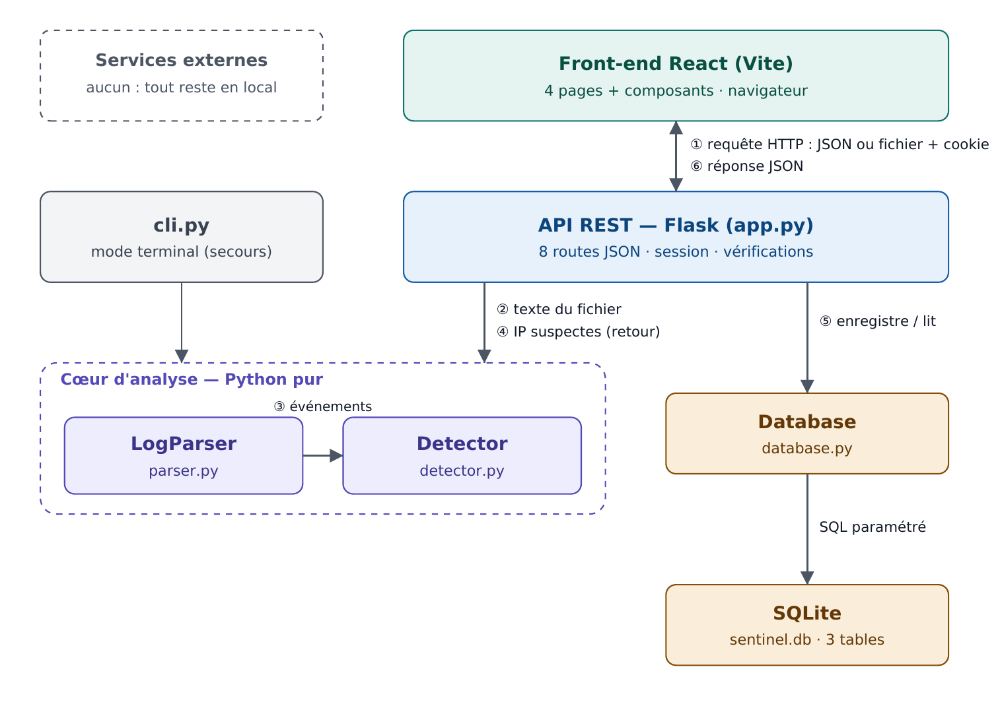
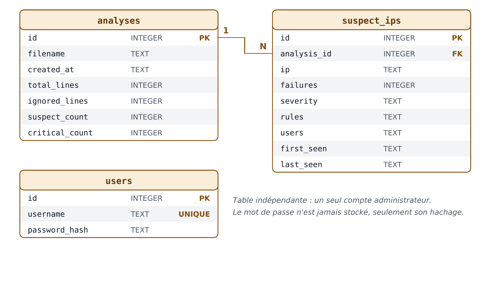

# SentinelSSH

**Analyseur de logs SSH — sécurité défensive.** SentinelSSH analyse le journal de connexions SSH d'un serveur Linux
(`auth.log`), repère les adresses IP suspectes, leur attribue une gravité et présente les résultats dans une
application web protégée par une connexion.

> Projet de fin d'année — Holberton School Bordeaux (Portfolio Project, Demo Day, titre RNCP niveau 5).
> Auteur : Anil AKER — [github.com/anil-akr](https://github.com/anil-akr)

<!-- À compléter en fin de projet : badge de la CI, capture d'écran de l'application, lien de la vidéo de démonstration -->

## Sommaire

1. [Fonctionnalités](#fonctionnalités)
2. [Architecture](#architecture)
3. [Base de données](#base-de-données)
4. [Technologies](#technologies)
5. [Installation (développement)](#installation-développement)
6. [Utilisation](#utilisation)
7. [API](#api)
8. [Tests](#tests)
9. [Déploiement (production)](#déploiement-production)
10. [Sécurité et RGPD](#sécurité-et-rgpd)
11. [Organisation du projet](#organisation-du-projet)
12. [Limites et évolutions](#limites-et-évolutions)

## Fonctionnalités

- **Connexion** par un compte administrateur unique (mot de passe haché, session par cookie).
- **Analyse d'un fichier** `auth.log` (.log ou .txt, 5 Mo maximum) : lecture des tentatives de connexion SSH.
- **Détection en 3 règles**, une gravité par règle :

  | Règle | Condition | Gravité |
  |---|---|---|
  | R1 — Attaque persistante | au moins 20 échecs dans le fichier | moyenne |
  | R2 — Force brute rapide | au moins 5 échecs en 60 secondes | élevée |
  | R3 — Compromission possible | une connexion réussie après au moins 5 échecs | critique |

- **Résultats** : verdict, chiffres clés, **carte du monde** des IP suspectes, classement des pays d'origine,
  graphique du top 10, légende des gravités et tableau trié par gravité avec une **fiche détaillée par IP**
  (localisation, opérateur du réseau, durée et rythme de l'attaque, règles expliquées).
- **Géolocalisation hors ligne** avec la base DB-IP Lite : aucune IP n'est envoyée à un service extérieur.
- **Commande de blocage** (`iptables`) prête à copier : l'outil propose, l'administrateur décide.
- **Historique** des analyses, suppression, liste des **IP récidivistes** (vues dans plusieurs analyses).
- **Page Confidentialité**, interface **responsive** (ordinateur et mobile), **mode terminal** de secours (`cli.py`).

## Architecture



- **Front-end** : React (Vite), 4 pages, toutes les requêtes dans `src/api.js`.
- **API** : Flask, 8 routes JSON, session obligatoire sauf pour la connexion.
- **Cœur d'analyse** : `LogParser` (lecture) et `Detector` (règles), en Python pur, sans dépendance au web ni à la base.
- **Géolocalisation** : `GeoLocator` lit les bases locales DB-IP (`backend/data/*.mmdb`) ; la position est calculée à
  chaque lecture d'une analyse, jamais stockée (décision D14).
- **Données** : `Database` (requêtes SQL paramétrées) et SQLite (3 tables).

Diagramme de classes : [docs/images/diagramme-classes.png](docs/images/diagramme-classes.png) ·
diagrammes de séquence : [connexion](docs/images/sequence-connexion.png), [analyse](docs/images/sequence-analyse.png),
[consultation](docs/images/sequence-consultation.png).

## Base de données



- `analyses` 1 → N `suspect_ips` (clé étrangère `analysis_id`, suppression en cascade).
- `users` contient le compte administrateur ; le mot de passe n'est jamais stocké, seulement son hachage.
- SQLite désactive les clés étrangères par défaut : `PRAGMA foreign_keys = ON` à chaque connexion.

## Technologies

| Couche | Technologies |
|---|---|
| Front-end | React, Vite, React Router, Recharts, d3-geo + world-atlas (carte), polices IBM Plex |
| Back-end | Python 3, Flask, Werkzeug (hachage), python-dotenv, maxminddb (lecture des bases DB-IP) |
| Base de données | SQLite (module `sqlite3`) |
| Production | Gunicorn |
| Qualité | pytest, pytest-cov, pycodestyle, ESLint, GitHub Actions, Postman |

Les justifications de chaque choix sont dans la [documentation technique](docs/stages/SentinelSSH_Stage3_Technical_Documentation.pdf) (§7).

## Installation (développement)

Prérequis : Python 3.10+, Node.js LTS, Git.

```bash
git clone https://github.com/anil-akr/sentinelssh.git
cd sentinelssh

# Back-end (terminal 1)
cd backend
python3 -m venv venv
source venv/bin/activate
pip install -r requirements.txt
cp .env.example .env               # puis remplacer SECRET_KEY (voir le fichier)
./scripts/download_geodb.sh        # bases de géolocalisation DB-IP (une fois par mois)
flask --app app create-admin       # une seule fois
flask --app app run                # API sur http://127.0.0.1:5000

# Front-end (terminal 2)
cd frontend
npm install
npm run dev                        # application sur http://localhost:5173
```

## Utilisation

1. Se connecter avec le compte administrateur.
2. Envoyer un fichier `auth.log`. Deux exemples sont fournis :
   - `demo/demo.log` : 3 IP de documentation (203.0.113.x), une par gravité ; elles n'ont pas de position sur la carte ;
   - `demo/demo-monde.log` : 13 vraies IP d'attaquants tirées du jeu de données public
     [Loghub](https://github.com/logpai/loghub), dans 13 pays (lignes générées pour déclencher les 3 règles).
3. Lire le verdict, la carte et le tableau ; ouvrir la fiche d'une IP ; copier une commande de blocage si besoin.

Mode terminal, sans interface web :

```bash
cd backend && python cli.py ../demo/demo.log
```

## API

Toutes les routes échangent du JSON. Les erreurs ont la forme `{"error": "message"}`.

| Méthode | URL | Session | Rôle |
|---|---|---|---|
| POST | `/api/auth/login` | non | Connexion (`{username, password}`) |
| POST | `/api/auth/logout` | non | Déconnexion |
| GET | `/api/auth/me` | oui | Utilisateur connecté |
| POST | `/api/analyses` | oui | Envoi d'un fichier (`multipart/form-data`, champ `file`) |
| GET | `/api/analyses` | oui | Historique des analyses |
| GET | `/api/analyses/<id>` | oui | Détail d'une analyse et de ses IP suspectes |
| DELETE | `/api/analyses/<id>` | oui | Suppression d'une analyse |
| GET | `/api/recidivists` | oui | IP présentes dans au moins 2 analyses |

Entrées et sorties détaillées : documentation technique, §5.

## Tests

```bash
cd backend
pytest --cov=sentinel          # tests unitaires et d'intégration + couverture
pycodestyle sentinel app.py cli.py
cd ../frontend && npm run lint
```

- **Unitaires** : `LogParser`, `Detector`, `Database`.
- **Intégration** : les 8 routes avec le client de test Flask et une base temporaire.
- **Manuels** : collection Postman (`docs/testing/`) et checklist de bout en bout (13 scénarios).
- **Robustesse** : dataset OpenSSH de [Loghub](https://github.com/logpai/loghub) (655 146 lignes).

Résultats : [docs/testing/test-report.md](docs/testing/test-report.md) — 77 tests, couverture de `sentinel` à 100 %,
fichier de 5 Mo analysé en moins de 0,4 s.

## Déploiement (production)

```bash
cd frontend && npm run build                  # crée frontend/dist
cd ../backend && source venv/bin/activate
flask --app app create-admin                  # si le compte n'existe pas
gunicorn -b 127.0.0.1:8000 app:app            # application complète sur http://127.0.0.1:8000
```

Flask sert le front construit et renvoie `index.html` pour toute adresse hors `/api`. La `SECRET_KEY` est lue
dans `.env` (jamais commité). L'application écoute uniquement en local : une mise en ligne demanderait un serveur,
Nginx et HTTPS (hors périmètre du MVP).

## Sécurité et RGPD

- Requêtes SQL paramétrées (injection SQL) ; affichage échappé par React, jamais `dangerouslySetInnerHTML` (XSS).
- Mots de passe hachés (Werkzeug) ; cookie de session HttpOnly et SameSite=Lax ; même message d'erreur que le nom ou le mot de passe soit faux.
- Fichiers limités à 5 Mo, extension vérifiée, contenu jamais écrit sur le disque.
- Aucune commande système exécutée : l'application n'a pas besoin des droits root.
- Une adresse IP est une donnée personnelle : seules les IP suspectes sont conservées, une analyse peut être
  supprimée, et la page Confidentialité informe sur les données traitées. Les analyses de plus de 30 jours sont
  supprimées automatiquement au démarrage de l'application (décision D11).

## Organisation du projet

- **Branches** : `main` (stable, taguée à chaque fin de sprint), `develop` (intégration), `feature/…` et `fix/…` (une par tâche).
- **Pull Requests** relues avec une checklist, **CI** GitHub Actions à chaque push.
- **Sprints** d'une semaine : [plan des sprints](docs/sprints/sprint-planning.md), revues et rétrospectives dans `docs/sprints/`.
- **Suivi** : GitHub Projects (kanban), issues et milestones ; bugs avec le label `bug`.
- **Décisions** : [journal des décisions](docs/decisions.md).
- **Documents du projet** : `docs/stages/` (Stages 1 à 4, conception complète).

## Limites et évolutions

- Un seul format de journal (Ubuntu classique) ; pas de lecture de journald.
- Analyse à la demande, pas en temps réel ; un seul compte administrateur.
- Géolocalisation approximative (base gratuite) : souvent la ville de l'opérateur, pas l'adresse exacte de l'attaquant.
- Pistes : plusieurs comptes et rôles, audit de `sshd_config`, surveillance en temps réel, alertes par e-mail.
