# Diagrammes de SentinelSSH

Diagrammes écrits en [Mermaid](https://mermaid.js.org/) : GitHub les affiche comme des images, et ils se mettent à
jour comme du code (texte versionné dans Git). Une copie en PNG de chacun est dans `docs/images/` (voir la
[liste à la fin](#images-png)).

À jour au 29/10/2026 : site multi-comptes (D20), profils (D21), sécurité (D22), audit (D23).

Sommaire : [cas d'utilisation](#cas-dutilisation) · [architecture](#architecture) ·
[base de données](#base-de-données) · [classes](#classes-du-back-end) ·
[inscription et connexion](#séquence--inscription-et-connexion) · [analyse](#séquence--analyse-dun-fichier) ·
[consultation](#séquence--consultation-dune-analyse) · [modification du compte](#séquence--modification-du-compte) ·
[CI](#intégration-continue) · [branches](#branches-git) · [production](#mise-en-production)

## Cas d'utilisation

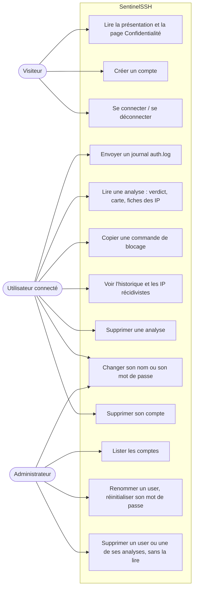

- Un visiteur devient utilisateur en créant un compte (rôle `user`).
- L'administrateur est créé seulement par `flask create-admin`, sur le serveur. Il peut aussi analyser ses propres
  journaux, mais ne peut pas supprimer son compte, et ne lit jamais les analyses des autres.

## Architecture

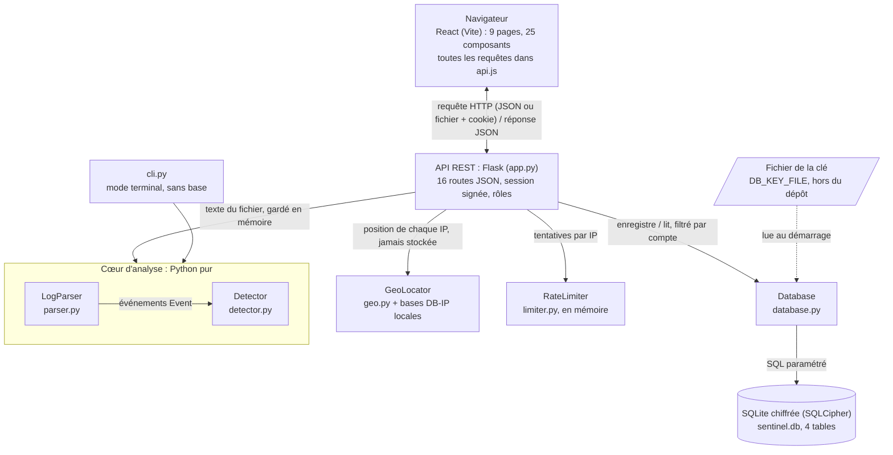

- Aucun service extérieur : la géolocalisation est faite par une base installée sur le serveur.
- Le cœur d'analyse ne connaît ni le web ni la base : `cli.py` et `app.py` s'en servent tous les deux.
- En développement, Vite (port 5173) transmet `/api` à Flask (port 5000). En production, Gunicorn sert l'API et le
  front construit sur le même port (8000).

## Base de données

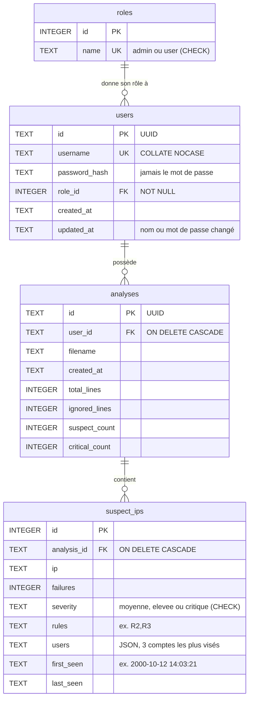

Cardinalités (Merise) :

- `users` (1,1) — (0,n) `roles` : chaque compte a exactement un rôle ; un rôle est partagé par plusieurs comptes.
  D'où la clé étrangère `role_id` dans `users`.
- `analyses` (1,1) — (0,n) `users` : chaque analyse appartient à un seul compte.
- `suspect_ips` (1,1) — (0,n) `analyses`.

Règles :

- Les comptes et les analyses ont un UUID pour clé : impossible à deviner, et il ne révèle pas combien il y en a.
  `suspect_ips` garde un entier : son id n'apparaît jamais dans l'API.
- Supprimer un compte supprime ses analyses, qui suppriment leurs IP (cascade, grâce à `PRAGMA foreign_keys = ON`).
  Un rôle utilisé ne peut pas être supprimé (pas de `ON DELETE` sur `role_id`).
- Le fichier envoyé n'est jamais stocké : seules les IP suspectes le sont (minimisation, RGPD).
- Tout le fichier `sentinel.db` est chiffré par SQLCipher (D22).

## Classes du back-end

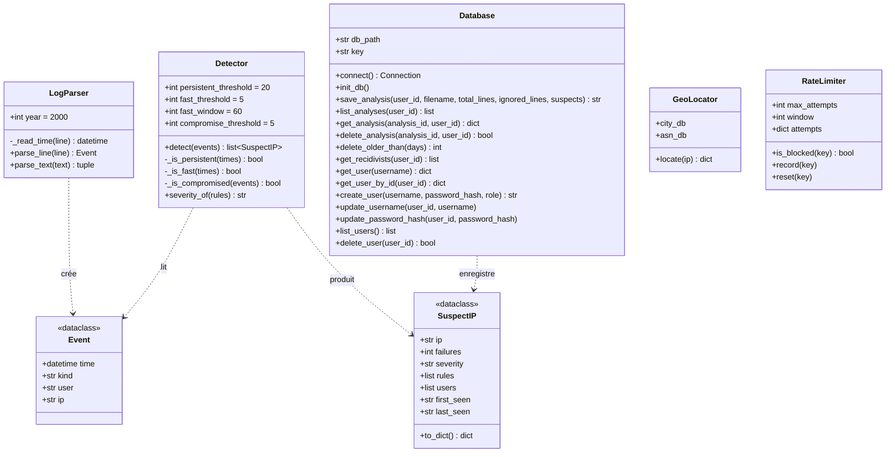

- `app.py` (routes Flask) utilise `LogParser`, `Detector`, `Database`, `GeoLocator` et deux `RateLimiter`
  (`login_limiter` : 5 échecs en 15 min ; `register_limiter` : 5 inscriptions par heure).
- `cli.py` utilise seulement `LogParser` et `Detector`.
- `database.py` a aussi deux fonctions : `now()` (date ISO 8601 à la milliseconde) et `new_id()` (UUID v4).

## Séquence : inscription et connexion

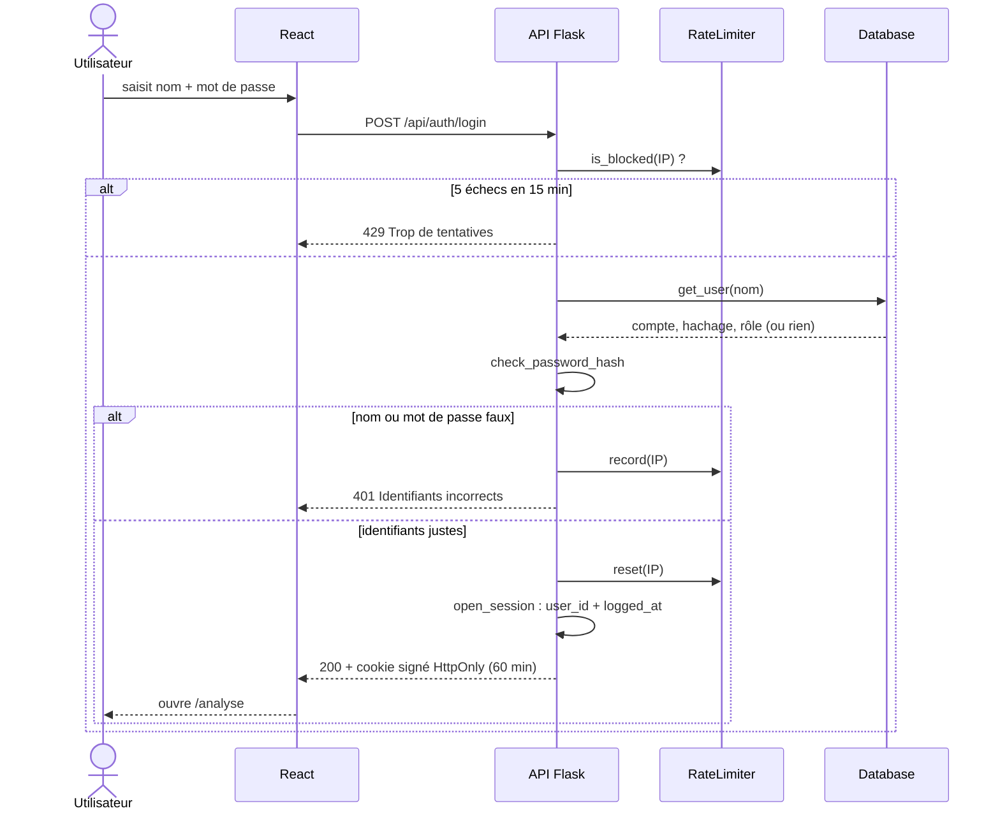

L'inscription (`POST /api/auth/register`) suit le même chemin, avec `register_limiter` (5 tentatives par heure et
par IP). Elle vérifie le nom (3 à 30 caractères) et le mot de passe (12 à 128), puis appelle `create_user` (rôle
`user`, mot de passe haché) et ouvre la session. Un nom déjà pris répond 409, même avec d'autres majuscules.

## Séquence : analyse d'un fichier

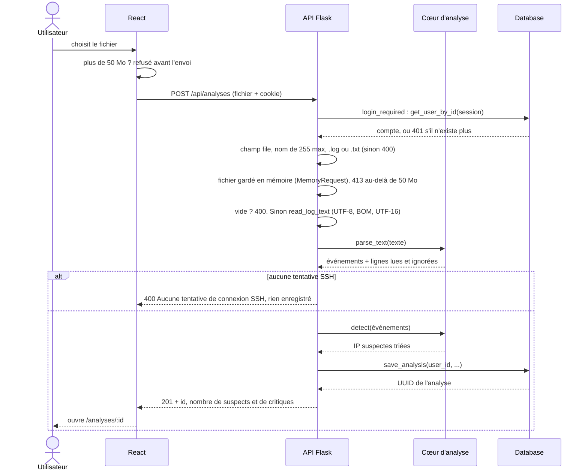

## Séquence : consultation d'une analyse

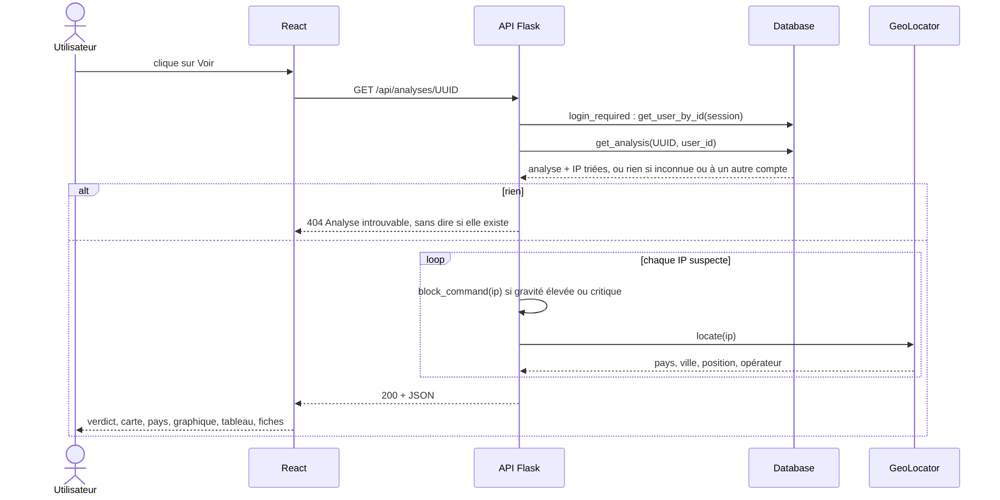

La commande de blocage et la position sont calculées à chaque lecture, jamais stockées (D13, D14).

## Séquence : modification du compte

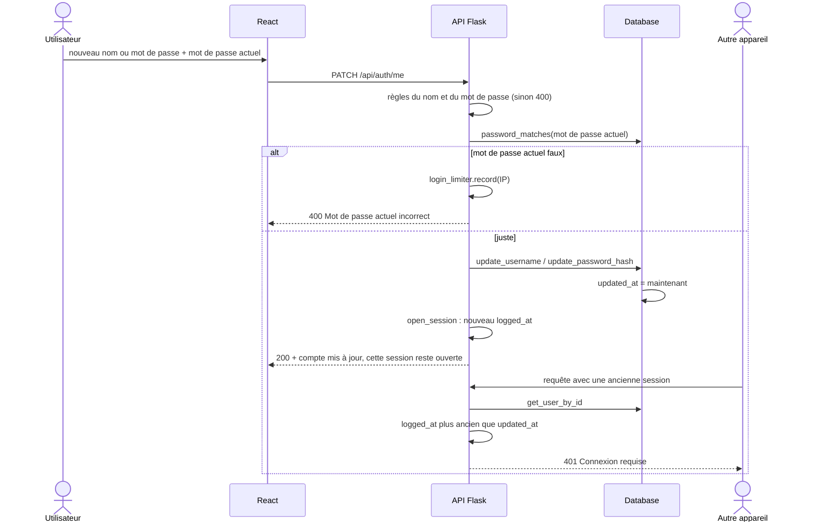

- L'administrateur fait la même chose pour un user par `PATCH /api/users/<id>`, sans mot de passe actuel. Toutes les
  sessions du user sont alors refusées (D22).
- Un compte admin ne se gère jamais par `/api/users/<id>` (403) : il modifie son propre compte par `/api/auth/me`.

## Intégration continue

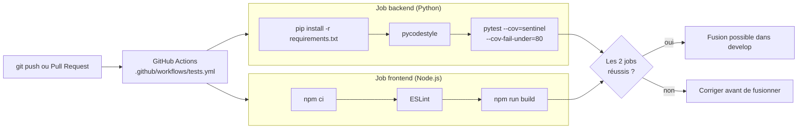

## Branches Git

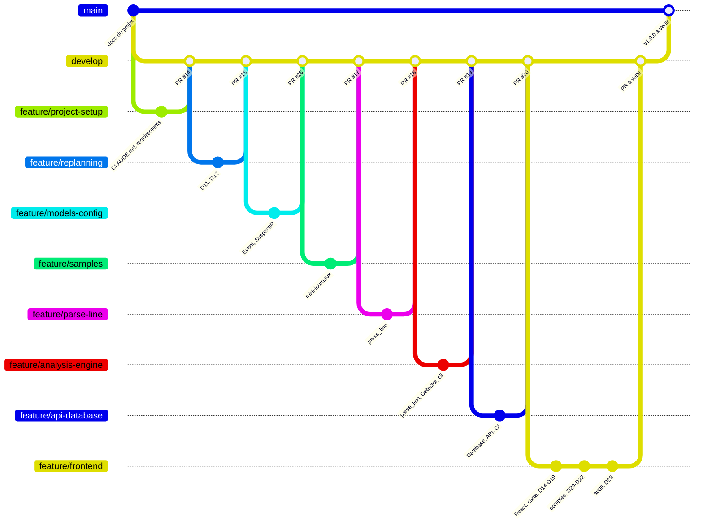

- `main` : stable, protégée ; elle recevra `develop` à la fin, avec le tag `v1.0.0`.
- `develop` : intégration ; chaque fonctionnalité y arrive par une Pull Request (PR #14 à #20 fusionnées, la PR de
  `feature/frontend` reste à ouvrir).
- `feature/…` et `fix/…` : une branche par tâche, créée depuis `develop`.

## Mise en production

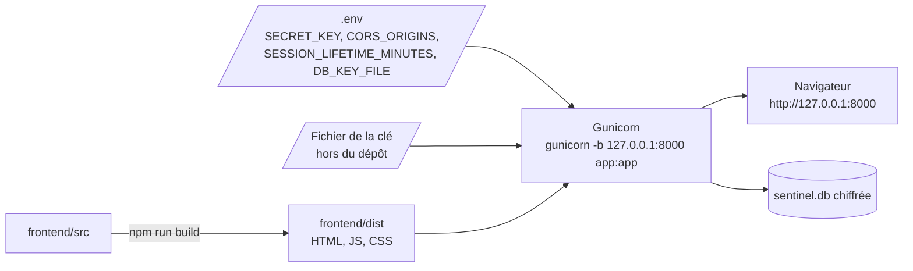

- Flask sert `frontend/dist` : un fichier qui existe est renvoyé tel quel, une route de React reçoit `index.html`,
  un fichier absent répond 404, et `/api/...` va aux routes de l'API.
- Au démarrage : création des tables si besoin, puis suppression des analyses de plus de 30 jours (D11).
- La mise en ligne (serveur, Nginx, HTTPS) n'est pas encore faite : le site écoute seulement en local.

## Images PNG

Copies des diagrammes ci-dessus, pour un document ou une présentation (régénérées le 29/10/2026).

| Image | Diagramme |
|---|---|
| `docs/images/cas-utilisation.png` | Cas d'utilisation |
| `docs/images/architecture.png` | Architecture |
| `docs/images/diagramme-base-de-donnees.png` | Base de données |
| `docs/images/diagramme-classes.png` | Classes du back-end |
| `docs/images/sequence-connexion.png` | Inscription et connexion |
| `docs/images/sequence-analyse.png` | Analyse d'un fichier |
| `docs/images/sequence-consultation.png` | Consultation d'une analyse |
| `docs/images/sequence-compte.png` | Modification du compte |
| `docs/images/pipeline-ci.png` | Intégration continue |
| `docs/images/branches-git.png` | Branches Git |
| `docs/images/pipeline-deploiement.png` | Mise en production |

Les 3 maquettes (`maquette-accueil.png`, `maquette-detail.png`, `maquette-connexion-mobile.png`) datent de la
conception (Stage 3) : l'interface finale a évolué depuis (D14 à D21).
