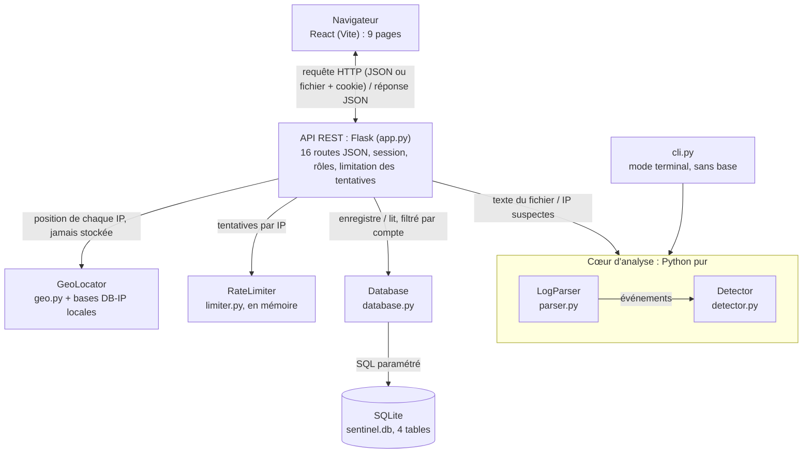
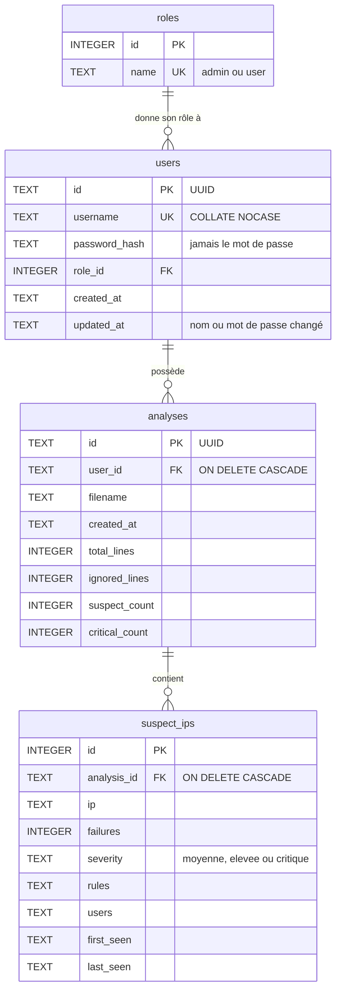
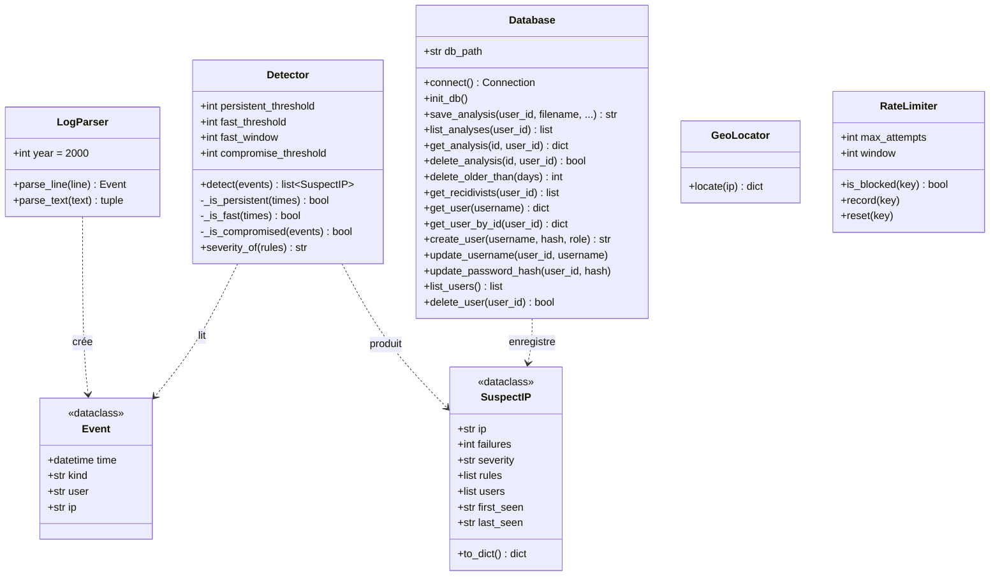
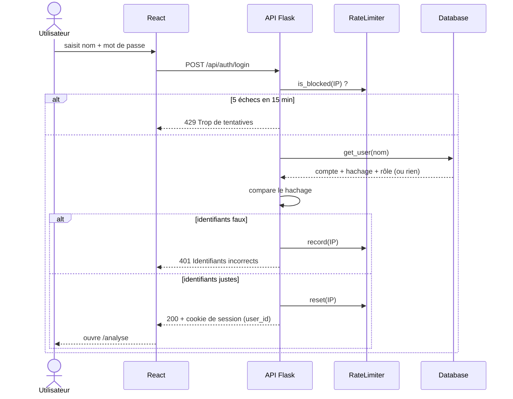
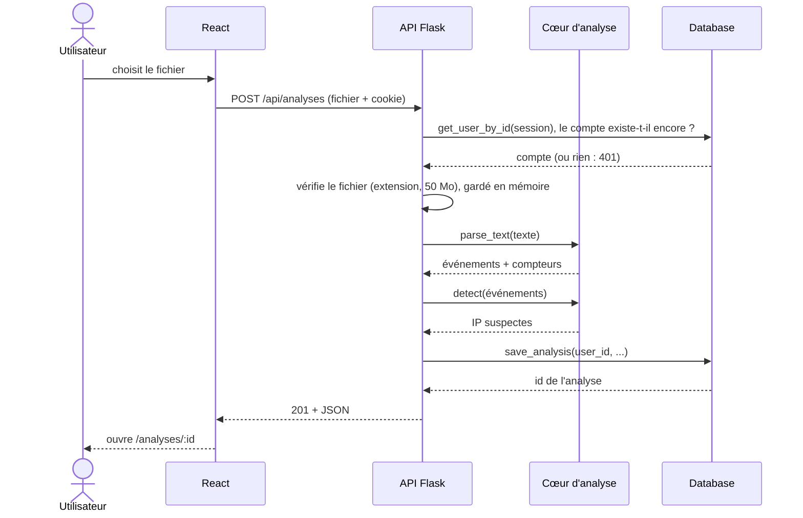
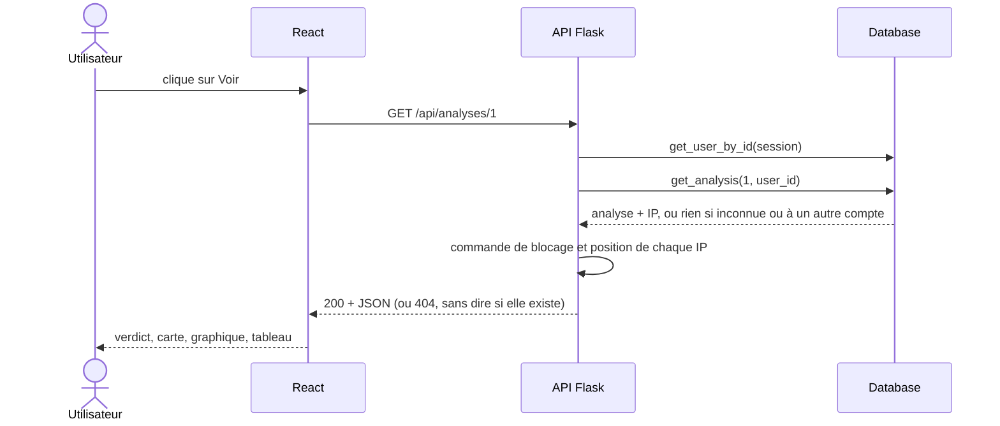

# Diagrammes de SentinelSSH

Diagrammes écrits en [Mermaid](https://mermaid.js.org/) : GitHub les affiche comme des images, et ils se mettent à
jour comme du code (texte versionné dans Git). À jour au 28/10/2026 (site multi-comptes et profils, D20 et D21).

## Architecture

Aucun service extérieur : la géolocalisation est faite par une base installée sur le serveur.

## Base de données

Cardinalités (Merise) :

- `users` (1,1) — (0,n) `roles` : chaque compte a exactement un rôle ; un rôle est partagé par plusieurs comptes.
  D'où la clé étrangère `role_id` dans `users`.
- `analyses` (1,1) — (0,n) `users` : chaque analyse appartient à un seul compte.
- `suspect_ips` (1,1) — (0,n) `analyses`.
- Les comptes et les analyses ont un UUID pour clé : impossible à deviner, et il ne révèle pas combien il y en a.
  `suspect_ips` garde un entier : son id n'apparaît jamais dans l'API.
- Supprimer un compte supprime ses analyses, qui suppriment leurs IP (cascade). Un rôle utilisé ne peut pas être
  supprimé (pas de `ON DELETE` sur `role_id`).

## Classes du back-end

`app.py` (routes Flask) utilise `LogParser`, `Detector`, `Database`, `GeoLocator` et `RateLimiter` ; `cli.py` utilise
seulement `LogParser` et `Detector`.

## Séquence : inscription et connexion

L'inscription (`POST /api/auth/register`) suit le même chemin : 5 tentatives par heure et par IP, puis
`create_user` (rôle `user`) et ouverture de la session.

## Séquence : analyse d'un fichier

## Séquence : consultation d'une analyse

